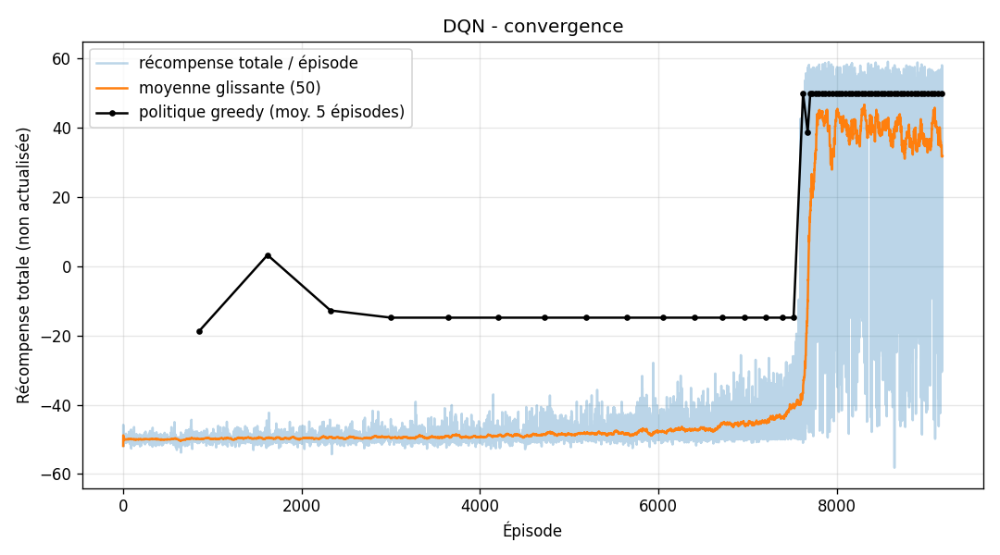
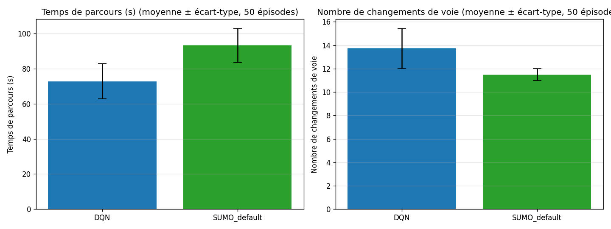

# ProjetRLOC – DQN pour le changement de voie (SUMO)

Agent DQN (stable-baselines3) qui décide des changements de voie d'un véhicule autonome
sur une autoroute à 2 voies avec obstacles immobiles. La vitesse est gérée par SUMO.

Le DQN est comparé au modèle de changement de voie par défaut de SUMO : il termine le parcours
**environ 20 % plus vite**, sans collision et sans changement de voie inutile.

## Résultats

Évaluation sur 50 épisodes, avec les mêmes départs aléatoires pour les deux politiques :

| | DQN v2 | DQN v1 | SUMO par défaut |
|---|---|---|---|
| Temps de parcours moyen | **73,1 s** | 73,1 s | 93,7 s |
| Changements de voie | **11,5** | 13,2 | 11,5 |
| Changements inutiles (aucun obstacle visible devant) | **0** | 1,72 | 0 |
| Taux d'arrivée | 100 % | 100 % | 100 % |
| Collisions | 0 | 0 | 0 |

- `models/dqn_lanechange.zip` = modèle **v2** (pénalité −1 par changement de voie, entraîné en local).
- `models/dqn_lanechange_v1.zip` = modèle **v1** Colab (pénalité −0,1) : il zigzaguait sur les portions sans obstacle.

Courbe d'apprentissage (v2) :



Comparaison DQN vs SUMO (v1, Colab) :



## Installation

1. Installer **SUMO ≥ 1.16** ([eclipse.dev/sumo](https://eclipse.dev/sumo/)) et définir la variable
   d'environnement `SUMO_HOME` (sous Windows : `C:\Program Files (x86)\Eclipse\Sumo`).
2. Installer les dépendances Python :

```bash
pip install -r requirements.txt
```

## Utilisation

Sous Windows, double-cliquer sur un script du dossier `scripts/` :

| Script | Rôle |
|---|---|
| `scripts/1_tester_le_modele.bat` | Teste le modèle sans interface : DQN vs SUMO par défaut sur 30 départs, tableau + CSV |
| `scripts/2_voir_DQN_dans_sumo_gui.bat` | Montre le DQN conduire dans sumo-gui |
| `scripts/3_voir_SUMO_par_defaut.bat` | Même scénario conduit par le modèle de changement de voie par défaut de SUMO |
| `scripts/4_tensorboard.bat` | Ouvre les courbes d'entraînement v2 et v1 (puis aller sur http://localhost:6006) |

Ou en ligne de commande depuis la racine du projet :

```bash
python test_model.py --episodes 30
python test_model.py --model models/dqn_lanechange_v1.zip   # ancien modèle
python simulate_gui.py --policy dqn                          # départ fixe
python simulate_gui.py --policy dqn --random-start --seed 3
python simulate_gui.py --policy sumo
python compare_policies.py --episodes 50                     # Q-learning vs DQN vs SUMO
python record_video.py                                       # vidéo MP4 dans videos/
python train_dqn.py --timesteps 150000                       # ré-entraîner en local (~15 min)
```

L'entraînement peut aussi se faire sur Google Colab avec `notebooks/DLmodel.ipynb`.

## Structure

```
data/                   scénario SUMO (réseau, obstacles, configuration, vue)
lane_change_env.py      environnement Gymnasium (état, actions, récompense)
train_dqn.py            entraînement DQN en local
test_model.py           test / évaluation du modèle sans interface
simulate_gui.py         visualisation dans sumo-gui
compare_policies.py     comparaison Q-learning vs DQN vs SUMO
record_video.py         enregistrement d'une vidéo de démonstration
models/                 modèles entraînés (DQN v2, DQN v1, Q-table)
notebooks/DLmodel.ipynb même chose en notebook Google Colab
scripts/                lanceurs Windows (.bat)
plots/, results/, runs/ courbes, CSV et logs TensorBoard du modèle v2
colab_results/          courbes, CSV et logs TensorBoard du modèle v1 (Colab)
```

## Formulation du problème

- **Actions** : 0 = garder la voie, 1 = voie de gauche, 2 = voie de droite (voie 0 = voie de droite dans SUMO)
- **État** (normalisé dans [0, 1]) : vitesse / v_max, distance libre devant dans la voie actuelle,
  dans la voie de gauche et dans la voie de droite (portée 100 m). Une voie inexistante ou occupée
  à côté du véhicule vaut 0.
- **Récompense par pas (1 s)** : v / v_max − 0,2 ; −1 par changement de voie (un changement n'est rentable que pour éviter un obstacle) ;
  −50 et fin d'épisode en cas de collision (bord de route ou obstacle) ; +10 à l'arrivée.
  Épisode tronqué à 200 s (véhicule bloqué).

## Hyperparamètres DQN

MLP 4 → 64 → 64 → 3 (ReLU), lr 5e-4, γ = 0,95, buffer 50 000, batch 64, learning_starts 2 000,
train_freq 4, target_update_interval 1 000, ε : 1,0 → 0,005 sur 30 % de 150 000 pas.
